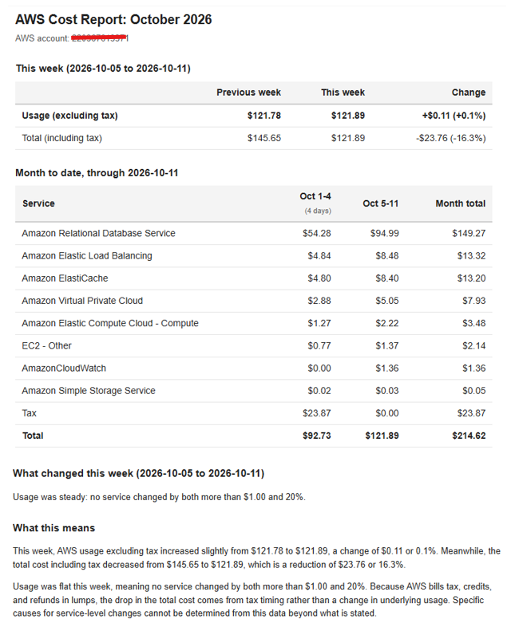
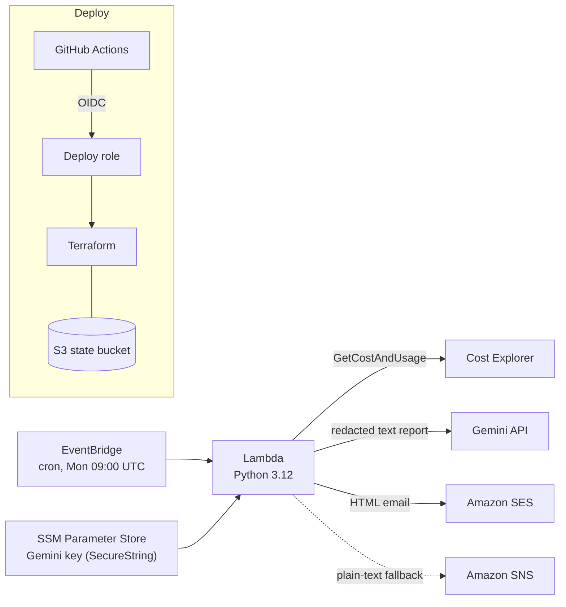

# aws-cost-explainer

A weekly AWS cost report sent by email. A Python Lambda pulls the last two full weeks (Monday to Sunday) from Cost Explorer and works out which services changed in a meaningful way (by default, at least $1 **and** at least 20%, or a service that is new or no longer billed). Gemini then writes a short plain-English explanation of those numbers. Python works out what changed, and the LLM only puts it into words. If Gemini fails, times out or has no key, the report still goes out without the explanation.



*Example email. The account number is redacted in the screenshot.*

## Architecture



Each run:
1. **fetch**: get daily costs by service for the last 14 days and sum them into two weeks.
2. **compare**: compute totals, usage excluding tax, and the top movers. No LLM is involved.
3. **explain**: redact the plain-text report and send it to Gemini. Any failure returns `None`.
4. **deliver**: send an HTML email through SES with a week summary, a month-to-date table by week, the movers and the explanation. If SES fails for any reason, the plain-text report goes out through SNS instead.

## Design principles

- **Python decides, the LLM explains.** The thresholds, totals and movers are computed by plain Python. The model gets a finished report, is told to use only those numbers and not to guess causes, and its output is capped at 400 tokens and 1,500 characters.
- **Redact before anything goes to the LLM.** `redact.py` removes ARNs, 12-digit account IDs, AWS access keys, bearer tokens, API keys and long high-entropy strings. The prompt is also capped at 4,000 characters, and the model is told to treat the report as untrusted data.
- **The account number never reaches the LLM.** It is looked up with STS only when the HTML email is rendered. It is never part of the text report that goes to Gemini.
- **The report works without the LLM.** A missing key, an HTTP error or a timeout is logged and skipped. Setting `use_llm = false` in Terraform turns the explanation off completely.
- **Usage leads, excluding tax.** AWS bills tax in lumps (for example, at the start of the month), which makes the total jump around. The report leads with usage excluding tax and shows the total including tax underneath.

## Repo layout

| Path | Purpose |
|---|---|
| `src/cost_explainer/fetch.py` | Calls Cost Explorer for daily costs by service and splits them into two weeks |
| `src/cost_explainer/compare.py` | Compares the two weeks: totals, usage excluding tax, top movers, and the plain-text report |
| `src/cost_explainer/redact.py` | Removes account IDs and secret-looking strings |
| `src/cost_explainer/llm.py` | Gemini request with caps, a timeout and a fallback to `None` |
| `src/cost_explainer/monthly.py` | Month-to-date table, grouped into Monday-to-Sunday weeks |
| `src/cost_explainer/report_html.py` | HTML email with inline styles |
| `src/cost_explainer/deliver.py` | SES HTML email, SNS plain-text email, and the account ID lookup |
| `src/cost_explainer/handler.py` | Lambda entry point that runs fetch, compare, explain and deliver. Configured with environment variables |
| `src/cost_explainer/__main__.py` | Small CLI that prints the text report from a JSON file or the bundled sample |
| `tests/` | pytest tests with fake AWS and HTTP clients, so no network access is needed |
| `examples/sample_cost_data.json` | Sample Cost Explorer response for local runs |
| `bootstrap/` | **One-time setup, applied locally:** the S3 state bucket, the GitHub OIDC provider and the deploy role. CI never destroys it. |
| `terraform/` | **The app:** Lambda, EventBridge schedule, SNS, SES identity, SSM parameter and IAM. CI applies and destroys it. |
| `.github/workflows/cicd.yml` | Lint, tests and the Terraform plan, apply and destroy pipeline |

## Deploy

### Prerequisites
- An AWS account and local admin credentials (only needed for bootstrap)
- Terraform 1.11 or later
- A Gemini API key
- A GitHub repo for this code

### 1. Bootstrap (once, locally)
If you forked the repo, first set `local.repo` in `bootstrap/main.tf` to your repo. It uses GitHub's ID-based OIDC subject format, `owner@owner_id/repo@repo_id`.

The bootstrap stores its own state in the bucket it creates, so the first run needs local state:

```bash
cd bootstrap
# 1. Comment out the backend "s3" block in main.tf
terraform init
terraform apply
# 2. Restore the backend block, then move the state into the new bucket
terraform init -migrate-state -backend-config="bucket=$(terraform output -raw state_bucket)"
```

Note the outputs `state_bucket` and `deploy_role_arn`.

### 2. GitHub settings

| Kind | Name | Value |
|---|---|---|
| Secret | `GEMINI_API_KEY` | Your Gemini API key |
| Secret | `NOTIFICATION_EMAIL` | The address that sends and receives the report |
| Variable | `AWS_ROLE_ARN` | The `deploy_role_arn` output |
| Variable | `TF_STATE_BUCKET` | The `state_bucket` output |

### 3. Pipeline
| Trigger | What runs |
|---|---|
| Pull request | ruff, pytest, `terraform fmt -check`, `validate` and `plan` |
| Push to `main` | The same checks, then `terraform apply` |
| Manual dispatch (`plan` / `apply` / `destroy`) | Terraform only. Run it from `main`, because the deploy role trusts only `main` and pull requests. |

A concurrency group makes sure two Terraform runs never overlap.

### 4. Confirm two emails
After the first apply, AWS sends two emails to `NOTIFICATION_EMAIL`. Click the link in both:
- **SNS subscription confirmation.** SNS delivers nothing to an email address until the subscription is confirmed. This is the plain-text fallback.
- **SES identity verification.** In the SES sandbox, both the sender and the recipient must be verified. This one address is both. Until it is verified, SES sends fail and every report falls back to SNS.

The report runs every Monday at 09:00 UTC (`schedule_expression`). To run it right away, invoke the Lambda from the console or the CLI.

## Run locally / tests

```bash
python -m venv .venv
source .venv/bin/activate        # Windows: .venv\Scripts\activate
pip install -e ".[dev]"

ruff check .
ruff format --check .
pytest
```

Print the text report from the bundled sample data (no AWS, no LLM):

```bash
python -m cost_explainer --sample
```

Run the full handler pipeline without sending anything:

```bash
USE_SAMPLE_DATA=true DRY_RUN=true USE_LLM=false \
  python -c "import os; from cost_explainer.handler import run; run(os.environ)"
```

PowerShell:

```powershell
$env:USE_SAMPLE_DATA="true"; $env:DRY_RUN="true"; $env:USE_LLM="false"
python -c "import os; from cost_explainer.handler import run; run(os.environ)"
```

| Variable | Effect |
|---|---|
| `USE_SAMPLE_DATA=true` | Read `examples/sample_cost_data.json` instead of calling Cost Explorer |
| `DRY_RUN=true` | Print the text report and explanation instead of sending email |
| `USE_LLM=false` | Skip Gemini |
| `GEMINI_API_KEY` | Set it, and leave `USE_LLM` unset, to include the explanation locally |
| `GEMINI_MODEL` | Override the default model (`gemini-3.5-flash-lite`) |
| `MIN_ABS_CHANGE`, `MIN_PCT_CHANGE`, `TOP_N` | Mover thresholds (defaults: `1.0`, `20.0`, `5`) |

If you drop `USE_SAMPLE_DATA`, the dry run reads real Cost Explorer data with your local AWS credentials. Each request costs $0.01.

## Security and permissions

- **Least-privilege Lambda role.** It can call `ce:GetCostAndUsage`, `sns:Publish` on its own topic, `ses:SendEmail` on its own identity, `ssm:GetParameter` on the one key parameter, and write to its own log group. Nothing else.
- **Gemini key.** It is stored as an SSM `SecureString` and set with Terraform's write-only `value_wo` from an `ephemeral` variable, so it never appears in plan output or state. The Lambda reads it at runtime. To rotate it, update the secret and bump `value_wo_version` in `terraform/ssm.tf`.
- **No long-lived AWS keys.** GitHub Actions gets short-lived credentials through OIDC. The deploy role trusts only this repo's `main` branch and its pull requests.
- **State.** The S3 state bucket is versioned and encrypted, blocks public access, and uses S3-native locking.

## Cost

About **$0.01 to $0.02 per run**. Cost Explorer charges $0.01 per API request: one request for the two-week comparison and one for the month-to-date table, plus more if results are paginated. At one run a week, Lambda, EventBridge, SNS, SSM (standard parameter) and CloudWatch Logs (kept for 14 days) stay within the always-free tier. SES costs a fraction of a cent per email once its 12-month free tier ends.

## Limitations

- **SES sandbox and the sender domain.** The report is sent from your own verified address through SES. With a Gmail address, recipients see "via amazonses.com" and the email may be flagged. For real clients, use your own domain with DKIM and move SES out of the sandbox.
- **Month boundaries.** The month-to-date table covers the month in which the report week ends. If a week crosses a month boundary, the table shows only the new month.
- **AWS revises recent costs.** Cost Explorer data for the last few days can still change after the report is sent.
- **Per service, not per resource.** Costs are grouped by service, so the report can say that RDS went up but not which instance.
- **Only tax is excluded from usage.** Credits and refunds are netted into each service by Cost Explorer and are not separated out by this tool.
- **Broad deploy role.** For simplicity, the deploy role has service-wide permissions such as `lambda:*`, `sns:*` and `ses:*`. IAM is limited to `aws-cost-explainer-*` roles.
- **Gemini free tier.** Google may use data sent on the free tier. The report is redacted, but use a paid tier for real client data.

## Tear down

Run the workflow manually from `main` with `action: destroy`. This removes everything in `terraform/`. The bootstrap resources (state bucket, OIDC provider, deploy role) are meant to stay. If you are done with the project for good, remove them in this order, from `bootstrap/`. The bootstrap state is stored in the bucket it creates, so it has to come out first:

1. Remove the `backend "s3"` block and run `terraform init -migrate-state` to move the state back to a local file.
2. Empty the state bucket, including every object version and delete marker. The bucket is versioned, so `terraform destroy` fails on it otherwise.
3. Run `terraform destroy`.

## License

See [LICENSE](LICENSE).
